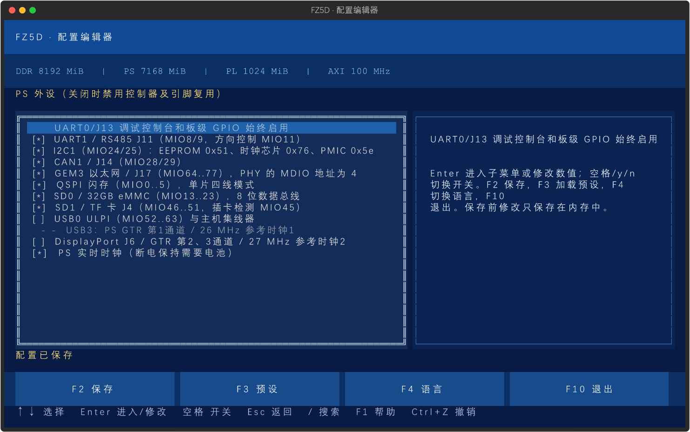

# 全屏终端配置 / Full-screen terminal configuration

在模板目录运行 / Run from the template directory:

```text
uv sync
uv run fz5-config --lang zh
uv run fz5-config --lang en
uv run fz5-config --lang both
```



直接运行即进入蓝底全屏编辑器。它使用终端的字符界面，不需要桌面窗口、Make 或 curses。Windows 可在 PowerShell 7 / Windows Terminal 中运行，Linux 可在支持 ANSI 的交互终端中运行。界面支持鼠标点击、滚轮和键盘，推荐至少100列、28行；80×24也可操作，此时用F1查看选项说明。不要把全屏界面的输入输出重定向到文件；自动化请用保留的 get/set/list 等子命令。

Launching the command opens the blue, full-screen editor. It runs inside the terminal and supports keyboard and mouse input on Windows and Linux. At 80×24 the details panel is hidden; F1 still opens the selected option's help. Use get/set/list subcommands for non-interactive scripts.

| 键 / Key | 操作 / Action |
|---|---|
| ↑ / ↓ | 选择 / Select |
| Enter / → | 进入分组或修改 / Open a group or edit |
| Space / y / n | 切换布尔开关 / Toggle or set a flag |
| Esc / ← | 返回上级或结束搜索 / Back or close search results |
| / / Ctrl+F | 按符号、中文或英文搜索 / Search names and Chinese/English descriptions |
| F1 / ? | 查看说明、依赖和范围 / Open help, dependencies and range |
| F2 / Ctrl+S | 保存配置和生成文件，继续编辑 / Save configuration and generated files |
| F3 | 加载预设到内存 / Load a profile into the editor |
| F4 | 中文、双语、英文循环 / Cycle languages |
| Ctrl+Z | 撤销上一项修改或预设加载 / Undo an edit or profile load |
| F10 / Ctrl+Q / q | 退出；有修改则询问保存/放弃/取消 / Exit with save/discard/cancel |

`[*]` 表示启用，`[ ]` 表示关闭，`(*)` 表示单选组当前项，`- -` 表示依赖未满足。Enter 修改整数时可以 Ctrl+A 全选。未保存修改带 `*`，不会写入磁盘。输入不符合范围、对齐或依赖要求时，编辑器显示错误并恢复原来的有效配置。

`[*]` means enabled, `[ ]` disabled, `(*)` a selected choice, and `- -` an unavailable dependency. Ctrl+A selects an entire numeric value. A `*` marks unsaved changes. Invalid edits roll back without changing saved files.

保存后仍由 Vivado 的 Tcl 读取配置并初始化工程 / After saving, initialize Vivado using Tcl:

```tcl
source tcl/init_project.tcl
```
